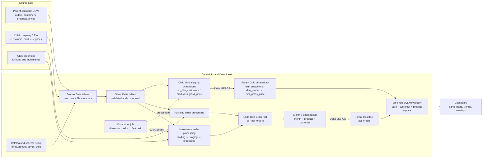

# FMCG Incremental Data Engineering Pipeline and Analytics Dashboard

> **Project report draft.** Replace bracketed institution and author fields before submission. Pipeline and dashboard screenshots are intentionally represented by placeholders. The descriptions below are based on the notebooks, SQL, sample data, and dashboard image supplied with the project. Validate workspace specific details and reported figures against the final Databricks run before submission.

## Title Page

**Project:** FMCG Incremental Data Engineering Pipeline and Analytics Dashboard  
**Submitted by:** [Student name / ID]  
**Programme / Department:** [Programme and department]  
**Institution:** [Institution name]  
**Supervisor:** [Supervisor name]  
**Academic year:** [Academic year]

## Abstract

This project implements a Databricks based data engineering and analytics workflow for a fast moving consumer goods (FMCG) business. It combines a parent company’s existing product, customer, price, and order data with a child company’s incoming data. CSV files are ingested into Delta tables, transformed through Bronze, Silver, and Gold layers, and joined into business dimensions and order facts. The order workflow supports an initial full load and recurring incremental loads. Incremental order data is staged, cleaned, matched to products, merged into persistent tables, and used to recalculate affected monthly product/customer aggregates in a parent fact table. A Databricks job named **FMCG Incremental update** coordinates customer, product, pricing, and fact processing tasks. A dashboard presents revenue, quantity, customer, channel, product, time, and price/quantity views.

The repository contains PySpark and SQL notebooks, sample CSV input, a dashboard query, an architecture asset, and a dashboard export. The implementation demonstrates layered data processing, Delta Lake `MERGE`, data cleaning, a dimensional model, and incremental aggregation. Results and exact KPI values should be verified against the latest dashboard refresh because the visible dashboard screenshot is a point-in-time output.

**Keywords:** Databricks, Apache Spark, Delta Lake, PySpark, incremental ETL, medallion architecture, FMCG analytics, dimensional modelling.

## Table of Contents

1. [Chapter 1: Introduction](#chapter-1-introduction)
2. [Chapter 2: Literature Survey](#chapter-2-literature-survey)
3. [Chapter 3: Requirements](#chapter-3-requirements)
4. [Chapter 4: Proposed Design](#chapter-4-proposed-design)
5. [Chapter 5: Implementation](#chapter-5-implementation)
6. [Chapter 6: Result Analysis](#chapter-6-result-analysis)
7. [Chapter 7: Conclusion](#chapter-7-conclusion)
8. [References](#references)

# Chapter 1: Introduction

## 1.1 Background

FMCG businesses handle frequent orders across products, customers, channels, and time periods. Operational data commonly arrives from separate business units and in file formats that vary in naming, data quality, and arrival time. Analysts need integrated, consistent data to compare sales, prices, customers, and product performance. Reprocessing all historical data for each arrival is inefficient and can make reporting slower. A well structured data pipeline therefore needs to combine initial historical loading with controlled incremental updates.

This project uses Databricks and Delta tables to build this workflow. The available data represents a parent company dataset and a child company dataset. The child data includes customers, products, gross prices, and orders. The pipeline cleans and standardizes those inputs, maps the child entities to parent model keys, and integrates the resulting records into a shared Gold layer. The dashboard query then exposes a denormalized view suitable for reporting.

## 1.2 Problem Statement

The project addresses the challenge of integrating FMCG source files into an analytics ready model while new order files continue to arrive. Input data can contain duplicates, inconsistent date and text formats, invalid identifiers, spelling variations, and price values that need validation. The processing must preserve existing data, add new records, and update monthly sales summaries for affected periods. Users also need a dashboard that makes key sales measures and trends accessible.

## 1.3 Aim

To design and implement a Databricks based data pipeline that processes parent and child company FMCG data through layered Delta tables, supports incremental order updates, and provides an analytics ready dataset for dashboard reporting.

## 1.4 Objectives

- Set up a Unity Catalog catalog and Bronze, Silver, and Gold schemas.
- Ingest source CSV files and retain file lineage metadata in landing layers.
- Clean and standardize customer, product, price, and order data.
- Build customer, product, gross price, date, and order fact tables.
- Use Delta Lake upserts to integrate child company dimensions and order facts with parent company tables.
- Support a full load and incremental order processing workflow.
- Recalculate monthly aggregates for months affected by newly received orders.
- Prepare an enriched query for dashboard use and report the observable dashboard outputs.

## 1.5 Scope

The report covers the supplied Databricks notebooks and SQL, the sample parent and child company datasets, the job task graph, and the dashboard represented in the supplied image. It describes the implemented transformations and intended data flow. It does not claim production service-level objectives, access-control configuration, automated data quality monitoring, or measured performance benchmarks because those were not established by the supplied artifacts.

## 1.6 Organization of the Report

Chapter 1 introduces the business problem and objectives. Chapter 2 summarizes relevant data engineering concepts. Chapter 3 states functional and non-functional requirements. Chapter 4 presents the architecture and data flow. Chapter 5 explains the notebook implementation. Chapter 6 provides result interpretation and image placeholders. Chapter 7 concludes with limitations and future work.

# Chapter 2: Literature Survey

## 2.1 Data Warehousing and Dimensional Modelling

A data warehouse organizes data for analysis rather than transaction processing. Dimensional modelling commonly separates measurable business events into fact tables and descriptive context into dimensions. In this project, orders form the business event, while product, customer, price, and date attributes provide analytical context. This structure supports questions such as revenue by month, channel, customer, or product category.

The supplied denormalized view joins the order fact to date, customer, product, and price dimensions. This is convenient for dashboard tools because measures and commonly used labels are available in one relation. Its correctness depends on matching the dimensions at the intended grain. For example, this implementation joins the date dimension at month start and joins gross price by product and order year.

## 2.2 ETL and ELT Processing

ETL describes extracting source data, transforming it, and loading a target system. ELT loads data into the analytical platform and performs transformations there. The project follows a lakehouse ELT pattern: CSV files are read by Spark, stored as Delta tables, and transformed using PySpark and SQL inside Databricks. Keeping an initial Bronze representation provides a traceable starting point for downstream cleanup.

## 2.3 Medallion Architecture

The medallion pattern divides data into progressively refined layers. Bronze holds ingested source data, Silver contains cleaned and conformed records, and Gold contains curated business tables and aggregates. This separation clarifies transformation responsibilities and makes it easier to inspect intermediate data. The notebooks define `fmcg.bronze`, `fmcg.silver`, and `fmcg.gold` schemas and write Delta tables in each layer.

## 2.4 Delta Lake and Incremental Processing

Delta Lake provides a transaction log and table operations for data stored in a lakehouse. Upsert operations such as `MERGE` can update matching business keys and insert new keys. This supports idempotent style integration when the merge keys are chosen correctly. The project uses Delta `MERGE` for customer, product, price, Silver order, and Gold order data. For incremental facts, it identifies months present in the incoming batch, selects the affected records, reaggregates them, and merges the recalculated monthly values into the parent fact table.

Incremental aggregation reduces the need to recompute every period, but requires careful handling of late arriving, corrected, or deleted records. The current notebook recalculates the full affected month from the child Gold fact table after merging the new batch. This is appropriate for monthly replacement-by-key aggregation when the source facts are complete for that month and the aggregation keys align with the target.

## 2.5 Data Quality and Standardization

Data quality work includes validating required values, parsing multiple date formats, removing duplicates, normalizing text, correcting known aliases, and applying consistent identifiers. The notebooks demonstrate these practices for customer names and cities, product names and categories, gross prices, and order dates. They also use fallback identifier values for malformed identifiers. Such defaults avoid dropping records but require monitoring because a shared fallback key can group unrelated invalid records together.

## 2.6 Business Intelligence and Dashboarding

Business intelligence dashboards translate curated data into measures, comparisons, and trends. The supplied dashboard shows headline KPIs, product and customer rankings, channel contribution, a monthly revenue trend, and a price versus quantity scatter plot. Interactive filters for year, quarter, month, channel, and category support exploratory analysis. Good dashboard interpretation depends on metric definitions, units, date grain, and the quality of the joined dataset.

## 2.7 Summary and Project Positioning

The project brings together established lakehouse practices: layered Delta storage, Spark transformations, dimensional data, and key based incremental merges. Its distinguishing implementation detail is the integration of a child business dataset into parent company dimensions and facts, with recalculation of only the affected monthly periods. The supplied artifacts establish the design and code paths; production readiness would additionally require stronger automated validation, operational monitoring, and documented recovery procedures.

# Chapter 3: Requirements

## 3.1 Stakeholders

- **Business analysts:** inspect sales and product performance using the dashboard.
- **Data engineers:** operate ingestion, transformation, and incremental update jobs.
- **Business data owners:** define mappings and confirm corrections such as customer city values.
- **Project reviewer:** assess the design, implementation, and evidence of outputs.

## 3.2 Functional Requirements

| ID | Requirement | Implementation evidence |
|---|---|---|
| FR-01 | Create a catalog and Bronze, Silver, and Gold schemas. | `setup_catalog.ipynb` |
| FR-02 | Generate a monthly date dimension with year, month, quarter, and surrogate date key. | `dim_date_table_creation.ipynb` |
| FR-03 | Ingest customer, product, and price CSV sources into Bronze Delta tables with read and file metadata. | Dimension processing notebooks |
| FR-04 | Clean and conform customer records, including duplicate removal, city normalization, name casing, and business confirmed fixes. | Customer processing notebook |
| FR-05 | Standardize product categories and names, derive division and variant, and generate a deterministic product code. | Product processing notebook |
| FR-06 | Parse price dates, validate price values, enrich prices with product codes, and produce a yearly product price. | Pricing processing notebook |
| FR-07 | Process an initial order load from landing files and move those files to a processed path. | Full load fact notebook |
| FR-08 | Process subsequent order files using staging tables and Delta merges. | Incremental load fact notebook |
| FR-09 | Recalculate monthly sales aggregates for months touched by an incremental batch and merge them into the parent fact. | Incremental load fact notebook |
| FR-10 | Enrich the fact data with date, customer, product, and price attributes for analysis. | `denormalise_table_query_fmcg.txt` |
| FR-11 | Present sales KPIs, trends, rankings, channel contribution, and product price/quantity analysis with filters. | Supplied dashboard image/PDF |
| FR-12 | Orchestrate dimension and fact tasks in a Databricks job. | `FMCG Incremental update` task graph image |

## 3.3 Non-Functional Requirements

- **Scalability:** use Spark and Delta tables so processing can scale with data volume.
- **Reliability:** preserve durable Delta tables and use transactional merge operations for updates.
- **Maintainability:** separate setup, dimensions, and fact logic into distinct notebooks and job tasks.
- **Traceability:** record ingestion timestamp and source file metadata in Bronze and intermediate data.
- **Usability:** expose business oriented dimensions and metrics to dashboard users.
- **Reproducibility:** parameterize catalog and source names through Databricks widgets where implemented.
- **Security:** run under workspace and cloud-storage permissions appropriate to the organization. Specific policies are outside the supplied implementation evidence.

## 3.4 Data Requirements

The inputs include parent company full-load CSVs for orders, customers, products, and gross prices; parent company incremental order data; child company customer and product files; gross price data; and order files organized into full-load landing and incremental folders. Order records include dates, order identifiers, customer and product identifiers, and quantities. Product and customer files provide descriptive attributes, and gross price records associate a price and month with a product.

The transformations expect consistent business keys for joining and merging. The product dimension generates `product_code` as a SHA-256 hash of the product name. Customer integration uses customer ID as the customer code. Orders are joined to products by product ID before being represented with the generated product code.

## 3.5 Software and Platform Requirements

- Databricks workspace with Apache Spark and Delta Lake support.
- Unity Catalog access for catalog and schema creation.
- Cloud object storage access to the configured `s3://sportsbar-final/` source locations.
- Databricks notebooks using PySpark and SQL.
- A Databricks Jobs and Pipelines workflow for task orchestration.
- A dashboarding capability that can query the Gold view or equivalent dataset.

## 3.6 Assumptions and Constraints

- Source paths and credentials are configured in the Databricks environment.
- Parent company Gold tables exist before child dimensions and facts are merged into them.
- The business has approved the hard-coded customer city corrections shown in the customer notebook.
- Monthly fact aggregation is intentional: daily order dates are truncated to month start for the parent aggregate.
- The sample data and screenshot may represent a particular project run rather than a continuously refreshed production dataset.
- The notebook output does not document automated retry policy, alerting, or a formal schema contract.

# Chapter 4: Proposed Design

## 4.1 Architecture Overview

The design follows a layered lakehouse flow. CSV files from parent and child company sources are read into Databricks. Dimension processing notebooks write raw or minimally augmented rows to Bronze, clean and conform them in Silver, and publish child dimension staging outputs to Gold before merging them into the parent Gold dimensions. Order processing has separate full-load and incremental paths. Incremental files are read from a landing directory, retained in Bronze, and moved to a processed directory. The cleaned orders are matched to products, merged into Silver and child Gold fact tables, aggregated by month/product/customer, and merged into the parent Gold order fact. The dashboard query joins this fact with dimensions to produce an enriched analytical view.

## 4.2 Architecture Diagram

The following Mermaid diagram is an editable representation of the implementation. It can be retained in Markdown or replaced with a designed architecture diagram.

**Figure 4.1.** Proposed architecture based on supplied notebooks and job workflow. Confirm the task dependency order and exact table/view names against the deployed workspace before final submission.

## 4.3 Job Orchestration Design

The supplied Databricks task graph is named **FMCG Incremental update** and shows four linked tasks: `dim_processing_customers`, `dim_processing_products`, `dim_processing_prices`, and `fact_processing_orders`. The first three dimension tasks run in sequence in the screenshot, followed by the fact task. This ordering ensures the product and other dimension outputs are prepared before fact processing. The tasks are configured as serverless in the provided screenshot. Include the actual job configuration and successful run evidence in Chapter 6 if available.

## 4.4 Data Model and Grain

The child company order data is converted into a child fact table with order-level attributes including order ID, date, customer code, product code, product ID, and sold quantity. The monthly aggregation groups by month-start date, product code, and customer code and sums sold quantity. The parent `fact_orders` target therefore represents monthly sales at the product/customer/month grain according to the notebook transformations. The dashboard query joins orders to dimensions and derives `total_amount_inr` as sold quantity multiplied by the matching price.

The dimension model includes:

- **Date:** month start, `date_key` (`yyyyMM`), year, month names, quarter, and year-quarter.
- **Customer:** customer code, display customer name, market, platform, and channel.
- **Product:** product code, division, category, product, and variant.
- **Gross price:** product code, price in INR, and year.
- **Order fact:** date, product code, customer code, and sold quantity; the child fact also retains order-level fields before parent monthly aggregation.

## 4.5 Incremental Processing Flow

1. Read the CSV files present in the incremental order landing directory.
2. Append source rows to the Bronze orders table and write the current batch to a Bronze staging table.
3. Move the input files to the processed directory.
4. Remove rows with missing quantity, normalize invalid customer IDs to a fallback, parse order dates, drop duplicates, and cast product IDs.
5. Join orders to the Silver product dimension to obtain the deterministic product code.
6. Merge the batch into the Silver order table and write the batch to a Silver staging table.
7. Project the batch into the child Gold fact and merge on the order/date/product/customer keys.
8. Determine distinct months present in the batch, select all child Gold fact records belonging to those months, and recompute monthly totals.
9. Merge those monthly totals into the parent Gold `fact_orders` table.
10. Drop temporary Bronze and Silver staging tables.

This flow is designed to account for prior records in an affected month when recalculating the aggregate. File movement marks processed input files operationally, while the Delta merge keys provide data level upsert behavior.

## 4.6 Security, Observability, and Recovery Considerations

The implementation relies on Databricks catalog permissions and cloud storage access. In a production deployment, least-privilege access should be granted to job identities, secrets should be stored in an approved secret manager, and table access should be governed through Unity Catalog. Operational observability should include job run status, processed file counts, row counts by layer, rejected or fallback-key counts, and freshness of the dashboard data. Recovery procedures should document how to replay a file and how to reconcile a partially completed run. These recommendations are design considerations; the supplied project artifacts do not demonstrate their configuration.

# Chapter 5: Implementation

## 5.1 Workspace and Catalog Setup

`setup_catalog.ipynb` creates the `fmcg` catalog and the `bronze`, `silver`, and `gold` schemas. `utilities.ipynb` defines schema name variables used in downstream notebooks. The date dimension notebook generates one row per month from January 2024 to December 2025, derives the year, month, quarter, year-quarter, and a `yyyyMM` integer key, and writes the result as `fmcg.gold.dim_date`.

## 5.2 Customer Dimension Processing

The customer notebook is parameterized with catalog and source widgets. It reads CSV data from the configured customer path, adds a read timestamp and file metadata, and writes a Delta Bronze table with Change Data Feed enabled. Silver processing drops duplicate customer IDs, trims customer names, standardizes city spelling, title-cases names, and applies a small set of business-confirmed city fixes by customer ID. Customer IDs are cast to strings. The notebook derives the display `customer` field and assigns market, platform, and channel attributes. It writes a child Gold staging dimension and merges the resulting customer records into the parent `fmcg.gold.dim_customers` table using customer code.

## 5.3 Product Dimension Processing

The product notebook reads and records source metadata in Bronze. Silver processing removes duplicate product IDs, normalizes category casing, corrects the spelling of “Protein” in product names and categories, maps categories to divisions, and extracts text inside parentheses as the variant. It generates `product_code` as a SHA-256 hash of the product name and converts invalid product IDs to a fallback value. The child product dimension is written to Gold staging and merged into `fmcg.gold.dim_products` by product code, updating descriptive attributes on matches and inserting new products.

Because the product code is based on product name, a product rename will produce a new code. A production model may prefer a governed source key or a persistent key mapping if names can change.

## 5.4 Gross Price Processing

The pricing notebook reads source price CSVs into Bronze. It parses the month using several date formats, converts valid numeric gross prices to doubles, makes negative prices positive, and sets nonnumeric values to zero. It joins to the Silver products table by product ID to obtain product codes, writes the enriched price data to Silver, and publishes a child Gold staging table. A window partitioned by product and year chooses the latest nonzero monthly price where available, then the result is merged into `fmcg.gold.dim_gross_price`.

## 5.5 Full Load of Orders

The full-load notebook reads CSV files from the order landing directory and appends the raw records with ingestion timestamp and file metadata to Bronze. It then moves the landing files into a processed directory. Silver cleanup removes missing quantities, normalizes customer IDs, strips weekday prefixes from date strings, parses multiple supported date formats, removes duplicate records, and casts product IDs to strings. The cleaned records are matched to the Silver products table to add product codes. The notebook creates or merges the Silver fact table, projects the required fields to a child Gold fact table, and aggregates data by month start, product, and customer. The aggregate is merged into the parent `fmcg.gold.fact_orders` table.

## 5.6 Incremental Load of Orders

The incremental notebook follows the same input and cleanup pattern, but writes each incoming batch to staging tables so the current batch can be isolated. It appends raw rows to Bronze, overwrites Bronze staging with the current batch, and moves landing files to processed storage. The enriched batch is merged into the persistent Silver table. A Silver staging table holds only the current batch for downstream projection. The child Gold order fact is upserted using the notebook’s compound key. The notebook then finds affected months and recalculates monthly product/customer totals from the child Gold fact before merging them into the parent fact. Temporary staging tables are dropped after processing.

## 5.7 Dashboard Dataset

The supplied SQL creates `fmcg.gold.vw_fact_orders_enriched` by joining the fact to the date, customer, product, and gross price tables. It selects descriptive attributes and calculates `total_amount_inr` as quantity multiplied by price. The dashboard screenshot includes filters for year, quarter, month, channel, and category. Visible analyses include total revenue, quantity sold, unique customers, average selling price, top products by revenue, channel revenue share, monthly revenue trend, customer revenue, top variant revenue, and a product price versus quantity scatter plot.

## 5.8 Implementation Artifacts

| Artifact | Purpose |
|---|---|
| `1_codes/1_setup/setup_catalog.ipynb` | Catalog and schema setup |
| `1_codes/1_setup/utilities.ipynb` | Layer variable definitions |
| `1_codes/1_setup/dim_date_table_creation.ipynb` | Monthly date dimension creation |
| `1_codes/2_dimension_data_processing/1_customers_data_processing.ipynb` | Customer ingestion, cleanup, and integration |
| `1_codes/2_dimension_data_processing/2_products_data_processing.ipynb` | Product standardization and integration |
| `1_codes/2_dimension_data_processing/3_pricing_data_processing.ipynb` | Gross price processing and integration |
| `1_codes/3_fact_data_processing/1_full_load_fact.ipynb` | Initial order ingestion and aggregation |
| `1_codes/3_fact_data_processing/2_incremental_load_fact.ipynb` | Incremental order ingestion and affected-month recalculation |
| `2_dashboarding/denormalise_table_query_fmcg.txt` | Enriched dashboard query |

## 5.9 Implementation Notes and Validation Points

The notebooks establish the intended processing path, but the following details should be checked in the deployed workspace before treating the report as a production specification:

- Confirm that the dimension table column names and schemas match the parent tables used by the `MERGE` operations.
- Confirm that the task graph dependencies are configured as shown and that the latest run completed successfully.
- The incremental notebook writes the current batch to staging and later recalculates months using the accumulated child Gold fact, which assumes that the child fact contains the full history for those months.
- Verify the compound merge keys against the actual fact table schema, including `order_id` availability in the relevant target.
- The query joins the date dimension using `fo.date = dd.month_start_date`; this is consistent with a monthly parent fact but should be revisited if daily facts are introduced.
- The shown query uses a left join to gross price by product and year. Confirm there is at most one price row for each product/year to prevent fact duplication.
- The dashboard KPI values should be refreshed and reconciled with the final data before submission.

# Chapter 6: Result Analysis

## 6.1 Pipeline Execution Evidence

The supplied Databricks job screenshot shows a four-task workflow titled **FMCG Incremental update**. The visual sequence is customer dimension processing, product dimension processing, pricing dimension processing, and order fact processing. The screenshot also indicates serverless compute for the tasks. Add the most recent successful run view if available so the report records completion status and run timestamp.

**[PLACEHOLDER: Insert Databricks job task graph screenshot here]**  
*Figure 6.1. FMCG Incremental update task workflow.*

**[PLACEHOLDER: Insert successful Databricks run details screenshot here]**  
*Figure 6.2. Job run status, duration, and task outcomes.*

## 6.2 Dashboard Results

The supplied dashboard screenshot shows an interactive FMCG performance overview. It displays filters for year, quarter, month, channel, and category. The KPI cards visible in the provided image report total revenue of **105.34B**, total quantity sold of **34.13M**, **54** unique customers, and average selling price of **4043.16**. These figures are transcribed from the supplied screenshot and should be checked against the current dashboard and metric definitions before final submission.

The visualizations provide several complementary views:

- **Top products by revenue:** compares the highest revenue generating products.
- **Revenue share by channel:** shows contribution by Retailer, Direct, and Acquisition channels.
- **Monthly revenue trend:** shows revenue by month, with a visible increase toward the final quarter in the screenshot.
- **Customer revenue table:** ranks customers by quantity and revenue.
- **Top variant revenue:** compares revenue across product variants.
- **Product price versus quantity:** displays the relationship between unit price and sold quantity, with bubble size/color encoding additional product group information in the dashboard.

These views support product assortment decisions, channel comparison, customer prioritization, and identification of monthly sales patterns. The screenshot alone does not establish the cause of a trend or validate that all totals reconcile to source data; such conclusions require query-level checks and documented metric definitions.

**[PLACEHOLDER: Insert FMCG dashboard screenshot here]**  
*Figure 6.3. Dashboard overview with filters and sales KPIs.*

**[PLACEHOLDER: Insert dashboard screenshot focused on product and channel charts here]**  
*Figure 6.4. Product rankings and revenue share by channel.*

**[PLACEHOLDER: Insert dashboard screenshot focused on monthly and customer analysis here]**  
*Figure 6.5. Monthly revenue trend and customer ranking.*

## 6.3 Result Summary

| Area | Result evidenced by supplied artifacts |
|---|---|
| Orchestration | Four linked Databricks tasks for customer, product, price, and order processing are shown. |
| Layering | Notebook logic creates and uses Bronze, Silver, and Gold schemas with Delta tables. |
| Data quality | Deduplication, trimming, casing, date parsing, price validation, and known value corrections are implemented. |
| Integration | Child dimensions and order data are merged into parent Gold tables using Delta operations. |
| Incremental behavior | Incoming batches are staged and affected monthly aggregates are recalculated. |
| Analytics | The enriched view/query and dashboard expose key sales KPIs and multi-dimensional analysis. |

## 6.4 Limitations of the Result Evidence

The dashboard image is a static snapshot. It does not show the filter selections, refresh timestamp, or the query output used for reconciliation. No benchmark results, row-count reconciliation report, error-rate report, or job run history was included in the inspected artifacts. Add these measurements if available; avoid presenting estimated performance or data quality rates as measured results.

# Chapter 7: Conclusion

## 7.1 Conclusion

This project demonstrates an end-to-end FMCG data pipeline in Databricks, from CSV ingestion through layered Delta transformations to a dashboard-ready analytical dataset. The implementation combines parent and child company data, standardizes customer and product attributes, processes prices, and handles both initial and incremental order loads. Delta Lake merges are used to integrate records, while affected monthly periods are recalculated and propagated into a parent fact table. The dashboard presents revenue and quantity KPIs, channel contribution, product and customer rankings, monthly trends, and price/quantity analysis.

The project meets its core objectives as represented by the supplied notebooks and screenshots. Before submission or production use, the deployed job status, table schemas, merge keys, monthly grain, price uniqueness, and dashboard metric calculations should be validated against the live Databricks environment.

## 7.2 Future Enhancements

- Add automated data quality rules and quarantine tables for invalid or unmatched records.
- Replace generic fallback IDs with explicit unknown dimension members and exception reporting.
- Add job monitoring, alerts, run metrics, and documented replay/recovery steps.
- Parameterize source locations and remove environment specific paths from notebook code.
- Add schema evolution and data contract checks for each source.
- Consider stable source identifiers for product keys where names can change.
- Validate and document fact and dimension grains, price effective dating, and KPI definitions.
- Add reconciliation checks between source, child Gold, parent Gold, and dashboard totals.
- Capture run history and refresh timestamp with final dashboard screenshots.

# References

1. Databricks, **What is the medallion lakehouse architecture?** Databricks Documentation. https://docs.databricks.com/en/lakehouse/medallion.html
2. Databricks, **Delta Lake: What is Delta Lake?** Databricks Documentation. https://docs.databricks.com/en/delta/index.html
3. Databricks, **Upsert into a Delta Lake table using merge.** Databricks Documentation. https://docs.databricks.com/en/delta/merge.html
4. Databricks, **Workflows.** Databricks Documentation. https://docs.databricks.com/en/jobs/index.html
5. Kimball, R. and Ross, M., **The Data Warehouse Toolkit: The Definitive Guide to Dimensional Modeling**, 3rd ed., Wiley, 2013.
6. Apache Spark, **Spark SQL, DataFrames and Datasets Guide.** https://spark.apache.org/docs/latest/sql-programming-guide.html
7. Project implementation artifacts: Databricks notebooks, SQL query, sample CSV files, job screenshot, and dashboard screenshot supplied with this project.
